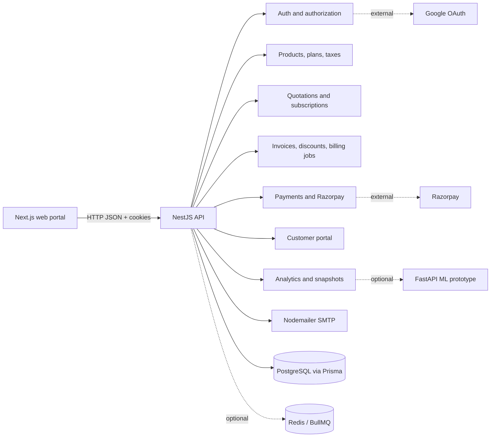

# System Architecture

## Overview

Subscription Management System is a modular-monolith application for customer onboarding, subscription lifecycle management, invoicing, payments, billing automation, and operational reporting.

The repository is split into deployable applications, while the API keeps domain boundaries as NestJS modules:

## Runtime components

| Component | Location | Responsibility |
| --- | --- | --- |
| Web application | `apps/web` | Next.js portal shell and customer-facing UI |
| API | `apps/api` | Authentication, authorization, business workflows, Swagger, validation |
| Database | PostgreSQL | Transactional system of record |
| ORM | Prisma | Schema, migrations, typed queries, transaction boundaries |
| Cache/queue | Redis and BullMQ | Optional asynchronous billing/mail processing |
| Mail | Nodemailer | Verification, reset, invitation, and notification messages |
| Payments | Razorpay integration | Payment orders and payment verification |
| Analytics prototype | `services/ml` | Optional experimentation boundary; not required by the API runtime |

## API request flow

1. `main.ts` creates the Nest application.
2. Configuration is loaded and validated by Joi.
3. Helmet, CORS, cookies, and the global `ValidationPipe` are registered.
4. Global guards apply JWT authentication, role checks, and the mandatory-password-change rule.
5. Controllers validate DTOs and delegate business rules to services.
6. Services use Prisma and return response-safe DTOs or explicitly shaped objects.
7. Swagger is exposed only when `NODE_ENV=development` and `SWAGGER_ENABLED=true`.

## Module boundaries

- `auth`: local login, Google OAuth, email verification, password reset/change, refresh rotation, logout.
- `users`: admin-only staff creation and user-facing staff/customer data operations.
- `products`, `plans`, `taxes`: catalog and pricing foundations.
- `quotations`: reusable quotation templates and template lines.
- `subscriptions`: subscription creation, state transitions, renewal, and closure.
- `invoices`: invoice generation, confirmation, cancellation, sending, and PDF output.
- `discounts`, `billing`: discount eligibility, usage reservation, invoice generation, and scheduled billing.
- `payments`: manual payments, Razorpay order creation, and payment verification.
- `portal`: customer-scoped subscription and invoice views.
- `analytics`: summary, MRR movement, aging, and plan reports.
- `mail`: SMTP transport and escaped Handlebars templates.
- `audit`: security and administrative audit entries.

## Security architecture

- Public routes are marked with `@Public()`; all other routes require the JWT guard.
- Roles are declared with `@Roles(Role.ADMIN, ...)` and checked by `RolesGuard`.
- Customer portal services receive the authenticated customer ID and apply it in the service query.
- Access tokens are short-lived JWTs. Refresh tokens are random values stored only as hashes and delivered using an httpOnly cookie.
- Refresh rotation revokes the old token. Reuse of a revoked token revokes its token family.
- Passwords are hashed with Argon2. OTPs and reset tokens are never returned.
- Global validation uses whitelist and `forbidNonWhitelisted`.
- CORS origins are configured through `CORS_ORIGINS`; do not use `*` with credentials.

## Important operational choices

- Redis/BullMQ are feature flags. Direct SMTP is the fallback when the queue is disabled or unavailable.
- Money is represented with Prisma `Decimal`, not JavaScript floating-point arithmetic.
- Workflow transitions are centralized in `src/common/state/transitions.ts`.
- PostgreSQL and Redis are supplied locally by `docker-compose.yml`.
- Swagger is intentionally disabled outside development.

