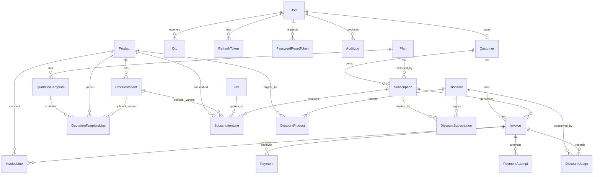

# Database Design

## Design goals

The PostgreSQL schema is the source of truth for users, customers, catalog data, subscription state, invoices, payments, and audit history. Prisma migrations are the only supported way to evolve the schema.

## Entity relationship overview



## Core tables

### Identity and security

| Model | Purpose | Important constraints |
| --- | --- | --- |
| `User` | Login identity and role | Unique normalized email; role index; lockout and verification fields |
| `Customer` | Customer profile linked one-to-one to `User` | Unique `userId`; signup creates both rows in one transaction |
| `Otp` | Verification, reset, or optional 2FA code | Indexed by `userId` and `purpose`; expiry, attempt count, and consumption state |
| `RefreshToken` | Hashed rotating session token | Unique hash; indexed by user and token family; replacement chain |
| `PasswordResetToken` | Hashed emailed reset token | Unique hash; expiry and single-use `usedAt` |
| `AuditLog` | Security and operational audit trail | Indexed by entity, user, and creation time |

### Catalog and selling

`Product` has optional `ProductVariant` rows. `Plan` defines a recurring offer and billing period. `Tax` defines percentage or fixed tax behavior. `QuotationTemplate` and `QuotationTemplateLine` provide reusable product bundles.

### Subscription and billing

`Subscription` belongs to a customer and plan, and contains `SubscriptionLine` rows. Its status follows the transition map in `src/common/state/transitions.ts`.

`Invoice` belongs to both a customer and subscription. Invoice periods are unique per subscription, which prevents duplicate billing for the same period. `InvoiceLine` stores the calculated values used for the invoice even if catalog prices later change.

`Discount` can target products, subscriptions, or both through join models. `DiscountUsage` is unique per discount/invoice pair, making discount application idempotent.

`Payment` records settled/manual payments. `PaymentAttempt` records provider checkout attempts and is linked to an invoice.

### Reporting and sequences

`MonthlySnapshot` stores precomputed reporting values. `Sequence` provides transaction-safe human-readable numbers such as `SUB-000123` and `INV-000123`.

## Transaction rules

- Signup creates `User` and `Customer` in one Prisma transaction.
- Staff creation creates the user and customer/profile data atomically where applicable.
- Subscription creation and line creation are transactional.
- Invoice generation reserves discount usage and creates invoice lines in one transaction.
- Payment verification updates payment attempt, payment, and invoice balance consistently.
- Sequence increments occur inside the same transaction as the resource being numbered.

## Delete behavior

- Identity-owned ephemeral data (`Otp`, refresh tokens, reset tokens) cascades from `User`.
- Customer and catalog references generally use `Restrict` to protect billing history.
- Audit rows preserve history when a user is removed by using `SetNull` for the optional user relation.

## Migration workflow

```bash
npm run db:generate
npm run db:migrate
```

For production, apply committed migrations with the deployment-safe Prisma migration command. Never edit the database manually and never commit a real `.env` or database credential.

